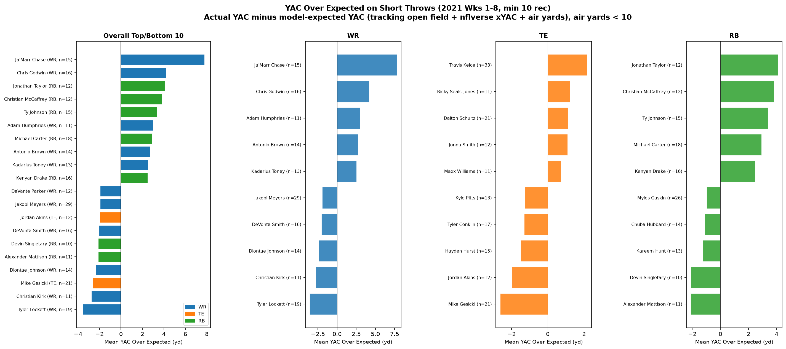
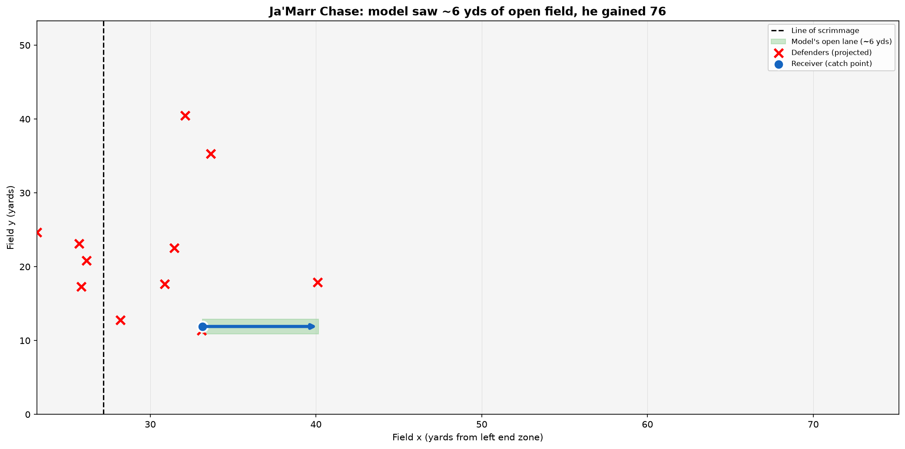

# YAC Over Expected: Who Actually Creates Yards After the Catch?



We used NFL tracking data at the moment of the throw to measure how much open field each receiver had, which we call "YAC Available." We combined that with air yards and expected YAC from nflverse to estimate how many yards after the catch each WR, TE, and RB should gain on short throws (under 10 air yards), then compared it to what they actually gained. On short throws, adding open field from tracking explains about 40% more of YAC than nflverse's expected YAC model does on its own, so where the defenders are at the throw really does matter. Even after accounting for that, Ja'Marr Chase (+7.8 yards per catch), Chris Godwin (+4.2), Jonathan Taylor (+4.1), and Christian McCaffrey (+3.8) gained the most beyond expectation, while Tyler Lockett (-3.6) and Mike Gesicki (-2.6) gained the least. This gives scouts a way to compare receivers without rewarding easy looks, and helps coaches decide who should get screens and quick throws.

## How it works

At the frame the ball is thrown, we move each defender toward the catch point while the ball is in the air. From the catch point, we run a "race" along a few possible running lanes: the receiver needs a moment to secure the ball and turn upfield, and a lane is blocked once any defender can get within a yard of a spot before the receiver does. YAC Available is how far downfield the receiver can get through the best lanes. We then fit a simple model (YAC Available, nflverse xYAC, and air yards) and rank players by how much their actual YAC beats the model.



The blue dot is Chase at the catch and the arrow is the best escape lane the model found, which gets cut off about 6 yards downfield. We can't see his actual run because tracking stops right after the throw, but he took it 76 yards.

## Results

| | |
|---|---|
| Completions analyzed | 4,436 |
| Short completions (air yards < 10) | 3,017 |
| Players ranked (min 10 short catches) | 117 |
| Short throws: R² of YAC, xYAC only | 0.093 |
| Short throws: R² of YAC, xYAC + YAC Available | 0.129 |
| All throws: R² of YAC, xYAC only / + YAC Available | 0.084 / 0.094 |
| Player-level correlation, YAC Available vs. YAC (short throws) | +0.23 |

YAC on a single play is very noisy (one broken tackle changes everything), so even the best model only explains a small share of it. The gain from tracking is biggest on short throws, which is also where yards after the catch matter most.

## Limitations

- Tracking ends about half a second after the throw, so we measure open field at the throw and not at the catch.
- Speeds (receiver 8.0 yd/s, defenders 7.5 yd/s), a 0.4 second catch-and-turn delay for the receiver, a 0.3 second defender reaction time, and a 1 yard tackle radius are assumptions, not fit from data. We picked the 0.4 second delay after seeing that the model overestimated open field without it.
- Blockers and sidelines are not modeled, so screens and sideline catches are the least accurate.
- The sample is only weeks 1 to 8 of 2021, and most players have 10 to 21 short catches, so the rankings are noisy.
- YAC, xYAC, and air yards come from nflverse's public play-by-play data.

## How to run

```
git clone https://github.com/ThompsonJamesBliss/nfl-big-data-bowl-regional-event-data
pip install -r requirements.txt
python analysis.py --data-dir path/to/nfl-big-data-bowl-regional-event-data/data
```

On Windows PowerShell, run `$env:PYTHONIOENCODING="utf-8"` first if you see encoding errors. The script downloads nflverse play-by-play on the first run (cached in `data_cache/`) and takes about 50 seconds.